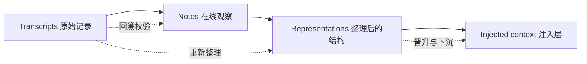
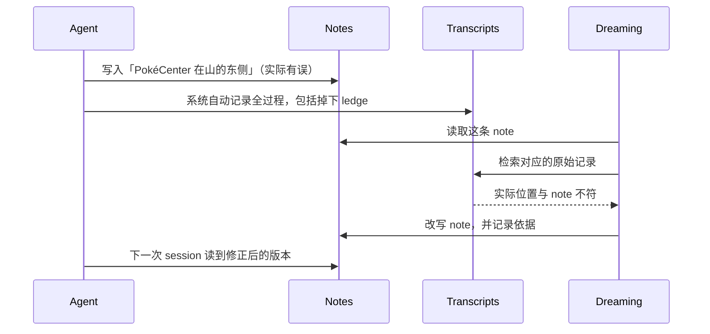
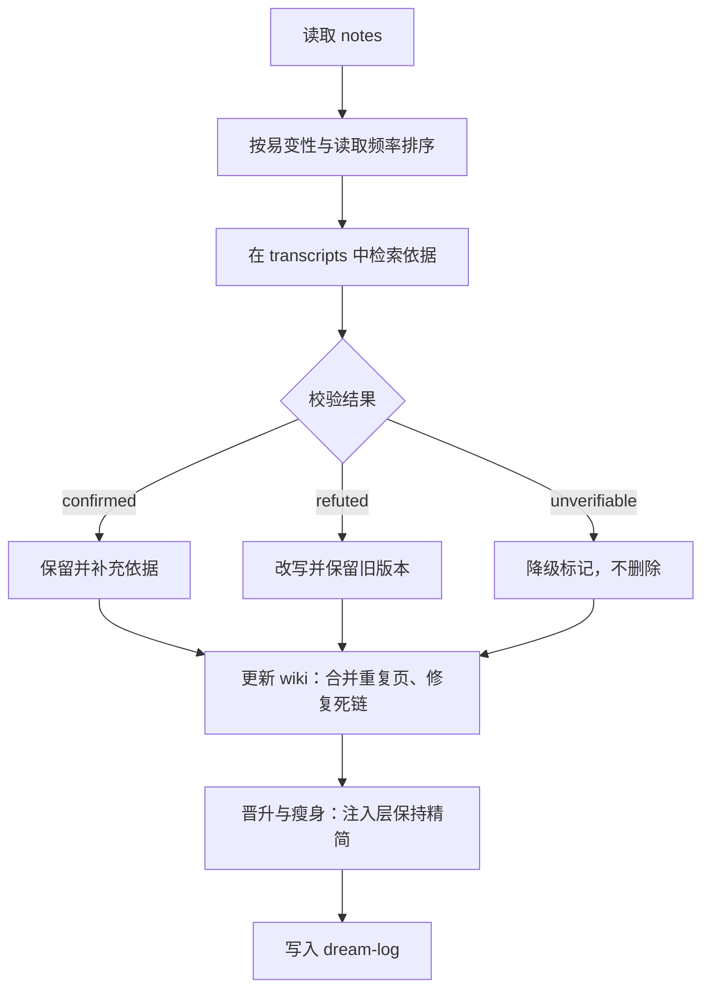

<KnowledgeMap current-module="memory" current-article="在线记录与离线整理：dreaming" />

# 先记下来，事后再整理：在线记录与离线整理

<ArticleHeader
  module="Memory 体系"
  :tags="['原理', '工程']"
  reading-time="20 分钟"
  prerequisite="已读 记忆的写入时机与遗忘策略、从 Episodic 到 Semantic 的蒸馏流程实战"
  summary="写入记忆的那一刻，Agent 无法判断什么重要；事后回看，才知道哪些记对了、哪些记错了。在线写入负责不丢，离线整理（dreaming）负责对，两者构成一个闭环。"
/>

前面几篇把记忆当作一条单向流水线：事件发生，判断是否写入，存入某种结构，之后检索或蒸馏。这条流水线有一个隐含前提：写入的那一刻，系统能判断什么值得记。本篇讨论这个前提不成立时，设计上如何补救。

## 先写后知的困境

Anthropic 在 2026 年 11 月发布的 [The components of agent memory](https://www.anthropic.com/research/components-of-agent-memory) 用克尔凯郭尔的一句话概括这个困境：生活只能向后理解，却必须向前度过。写入 memory 的时刻，Agent 不知道哪条信息之后会派上用场。

这篇文章的论述可以拆成三个层面：

1. 在线写入的质量，取决于模型对 salience（显著性）的判断，这一判断能力在较新的模型上明显提高。
2. 即便判断得好，在线写入的内容仍然可能一开始就是错的，或者随环境变化而过时。
3. 补救办法是离线整理：在 session 之间回看原始记录，纠错、重组、晋升。这一过程被称为 **dreaming**。

dreaming 并非 Anthropic 独有的概念。Letta 与 UC Berkeley 在 2025 年提出的 [sleep-time compute](https://arxiv.org/abs/2504.13171) 是直接来源，思路是利用交互间隙的空闲算力预先整理上下文。Letta 的文档里也有对应的 sleep-time（dream）subagent 设计：回看近期对话，把有用的经验写入记忆。

## 一个四层结构

Anthropic 把 session 之间的记忆分成四层，dreaming 在层与层之间搬运和校验：

| 层级 | 内容 | 写入者 | 读取方式 |
| --- | --- | --- | --- |
| Transcripts | 完整、可搜索的事件日志 | 系统自动记录 | 按需搜索 |
| Memory notes | Agent 写下的显著观察 | 在线，session 内 | 按需读取 |
| Memory representations | wiki 等带链接的结构 | 离线，dreaming | 按需导航 |
| Injected context | 每次 session 开头预加载的内容 | 离线晋升 | 自动注入 |



这个划分与《Memory 的四种形态》是正交的。In-context、External、Episodic、Semantic 描述的是信息所处的位置与性质，这里的四层描述的是**信息在系统里被加工到了哪一步**。同一条经验可能先是 transcript 里的一段对话，后来成为 note，再被整合进 wiki 的某一页，最后凝缩为注入层里的一行。

## 在线侧：salience 判断已经是模型能力

### 记什么，比记多少重要

文章用 *Pokémon Red* 做了对照。运行到约 10,000 步时，Claude Sonnet 3.7 写了 413 个 memory 文件（分布在 225 个文件夹，拿到 1 枚徽章），Claude Fable 5 只写了 9 个文件加一个 `global.md`（拿到 4 枚徽章）。

差异来自一个朴素的原则，可以称为**可再得性原则**：屏幕上每回合都能读到的信息（金钱、坐标）不值得存，只存环境不会重新告诉模型的东西，即策略、计划和验证过的规则。

较弱的做法是“什么都可能有用，所以都记”。记录很快过时，检索成本随之上升，最后连整理本身都在消耗行动预算：Sonnet 3.7 在第 10,000 步前后的 17 步里创建 6 个文件、删除 9 个，游戏内没有任何动作。

### 说明用途，不规定内容

在 CL-Bench 1.0 的数据库问答任务上，只告诉模型“存在一个 memory 目录”，Opus 4.7 与 Opus 5 就能把它用起来。明确规定“只记录失败”反而削弱了收益：Opus 5 的 memory 增益下降 0.234，Opus 4.7 下降 0.150。

这对《记忆的写入时机与遗忘策略》里的“重要性阈值触发”有直接含义。固定阈值与固定规则适合较弱的模型，或者需要确定性的场景。对较强的模型，更有效的做法是交代记忆的**用途**（它将在后续 session 中被读取，用来避免重复犯错），把“写什么”交给模型判断。

不同模型的差距还体现在记录的质量上：较弱的模型只列出未经检验的猜测；Opus 5 开始形成闭环，每条记录包含规则、依据以及踩过的坑。这个“规则加依据”的格式，与蒸馏 pipeline 里的 `source_episodes` 字段是同一个思路。

## 离线侧：dreaming 做的五件事

| 作用 | 做法 | 证据 |
| --- | --- | --- |
| 纠错 | 用 transcript 校验 note | Pokémon Mt. Moon：纠错后 1,935 步到达目标城市，未纠错的运行始终没有通过 |
| 构建 representation | 建立带链接的 wiki | 128 个 session 后，只用 wiki 回答 25 道题的得分从 13% 升到 48% |
| 晋升与瘦身 | 决定哪些进入注入层，其余下沉并留下链接 | Claude Code 的 auto memory 只加载 `MEMORY.md` 的前 200 行或 25 KB |
| 按目标定向 | 根据失败反思重写整理指令 | 合同条款任务：72%（41/57）升到 100%（57/57） |
| 补缺口 | 跨 session 发现死链、重复页 | 九条死链被重定向，新增三页（含 index） |

### 纠错：为什么频率验证不够

《从 Episodic 到 Semantic 的蒸馏流程实战》里的验证环节依赖统计信号：出现次数、时间跨度、是否矛盾。这套方法能过滤偶然，但抓不住另一类错误：**写入一次、之后被反复信任的错误记录**。

Mt. Moon 的案例是典型。Claude 误记 PokéCenter 在山的东侧，走出建筑后宣布“Mt Moon DONE”，随后掉下单向 ledge，并把结果解释成“走过头了”。这条错误没有重复出现，也没有与其他记录矛盾，统计验证无从发现。校验它的唯一办法是**回到原始记录对照**。



对 memory 跑一轮 dreaming 后，Claude 对照 transcript 找到错误并改写，随后直接回洞口，在第 1,935 步到达目标城市。未纠错的运行在同一处连续掉落三次，最终退回出发的城镇。

因此验证至少有两种机制，互相补充：

- **统计验证**：这条经验是否反复出现、是否稳定（蒸馏 pipeline 的做法）。
- **回溯验证**：这条记录是否与原始证据一致（dreaming 的做法）。

### 构建 representation：wiki 的收益条件

wiki 是一组由 Agent 维护、页面之间互相链接的笔记，链接构成检索时的导航图。在 Stainless 约 35 万个文件（约 4.2 亿 token）的语料上，wiki 与搜索组合使用的得分从 54% 升到 61%，只用搜索是 53%，只用 wiki 最高 48%，并且每题节省约 20,000 token。

收益并不均匀。在并购文档的 24 道题里，需要综合多份文档或做判断的题目，查 wiki 得分 87%，纯搜索 73%；而在答案大多能在单个文档里搜到的任务上，wiki 没有明显增益。另一个任务里，wiki 的体积达到语料的 1.77 倍（203 KB 对 115 KB），索引比被索引的对象还大，等于什么也没有抽象。

判断是否值得建 wiki，可以问两个问题：

- 任务是否需要跨文档综合？
- 语料是否大到单靠搜索效率不足？

两者都不满足时，维护 wiki 的成本通常高于收益。

### 并发写入：一个具体的失败模式

多个 agent 同时向同一份共享表格写入合同条款时，互相覆盖，57 条评分事实只保留了 41 条。改为每份合同一个 agent、一个页面、条款逐字引用后，57 条全部保留。这条规则可以直接用于多 Agent 系统：共享记忆默认应当是“一个写入者对应一个文件”，而不是多人共写一张表。

## 三个分析模型

### 心理学：互补学习系统

海马体快速编码，新皮层缓慢整合，睡眠与静息期间的重放把前者的内容逐步迁移到后者。这是 complementary learning systems 理论的核心。对应到 Agent：在线 note 是快速、容易出错的编码，离线整理是慢速、依赖证据的整合。Anthropic 的文章对神经科学部分措辞谨慎（“thought to”），类比的价值在于结构，不应当当作机制证明。

另一个相关的心理学现象是重构式记忆与确认偏误。Mt. Moon 里模型把失败解释为“走过头了”，旧信念被重新诠释而没有被修订。第二个视角（事后、对照原始记录）正是打破这种自我强化的手段。

### 经济学：持有成本与注意力稀缺

记忆有写入成本，更有检索时的注意力成本。无差别写入相当于囤积库存，库存越多，盘点越贵，还会贬值。Herbert Simon 的论断可直接套用：信息的丰富制造注意力的稀缺。注入层之所以必须小，原因就在这里：每一行都在占用每个 session 的注意力预算。

### 版本控制：不可变日志与可重写视图

Transcripts 只追加，是唯一的事实来源。notes、wiki、注入层都是由它派生的视图，可以被重写，也可以被回滚。Letta 的 context repositories 把这个思路推到底：记忆以 git 管理的文件形式存在，每次整理都是一次可审计的提交。

## 工程落地：文件系统式的最小结构

近一年的一个趋势是记忆工具从“专用的数据库接口”转向“通用的文件操作”。Letta 近期的调整把专用的 server 端记忆工具替换为对 git 管理的文件仓库的普通文件操作，sleep-time 工作流也从服务端迁到客户端的 subagent。Letta 此前的基准测试还发现，单纯把对话历史存进文件，在 LoCoMo 上就能得到 74.0%，高于若干专用记忆库。

一个够用的最小结构如下：

```text
memory/
├── MEMORY.md              # 注入层：索引 + 当前目标，控制在 200 行以内
├── notes/                 # 在线写入的观察，每条带「依据」字段
├── wiki/                  # 离线整理出的主题页，页面间用链接相连
│   └── index.md
├── transcripts/           # 只追加的原始记录（可搜索），不由 Agent 改写
└── dream-log.md           # 每轮整理做了什么，便于审计和回滚
```

一轮 dreaming 的流程：



骨架代码（示意，非可直接运行的实现）：

```python
def dream(memory_dir, budget):
    notes = load_notes(memory_dir)
    for note in prioritize(notes, by="volatility"):   # 易变、常被读取的优先
        evidence = search_transcripts(note.claim)
        verdict = llm_check(note, evidence)           # confirmed / refuted / unverifiable
        if verdict == "refuted":
            rewrite(note, evidence)                   # 改写并保留旧版本
        elif verdict == "unverifiable":
            mark(note, status="unverified")           # 降级，不删除
    update_wiki(notes)                                # 合并重复页、修复死链、补 index
    promote_and_demote(memory_dir, limit_lines=200)   # 注入层保持精简，细节下沉并留链接
    append_log(memory_dir)
```

一个贴近本站的设想例子：负责维护本站的 Agent 在一次会话中记下“下一模块的路径是 `/03-memory/04-multi-agent/`”，这个路径把模块目录嵌套错了（本模块早期几篇文章的“下一步”链接就出现过这类问题）。之后每次它都会沿用这个错误路径。一轮 dreaming 对照 transcript 里 404 的记录与站点的实际侧边栏配置，就能把这条 note 改写，并把依据一并记下。

## 触发节奏与成本

文章没有给出最优节奏，明确把它列为开放问题：持续检查全部记忆在算力上不现实，需要把整理集中在易变的信息上，或者按访问频率调整。以下为基于此的推演：

- 易变信息（环境状态、版本、路径）优先复查，稳定事实（用户偏好）降低频率。
- 被频繁读取的 note 优先验证，因为错误的影响面与读取次数成正比。
- 写入后第一次整理应当较快，早期错误的传播代价最低。

## 风险与边界

- **错误上浮。** 错误的 note 一旦晋升到注入层，会进入每个 session。晋升应当有门槛，并保留回滚路径。
- **wiki 膨胀。** 监控 wiki 体积与语料体积之比，超过 1 就应当怀疑它没有在抽象。
- **过度裁剪。** 有对该领域综述的解读指出，过于激进的剪枝会抹掉稀有但关键的知识。整理时倾向于归档，而不是删除。
- **日志的留存。** dreaming 依赖完整的 transcript，这与数据最小化、保留期限、访问控制之间存在张力，需要在《数据治理》模块里单独处理。

## 本节总结

- 在线写入无法预知价值，离线整理可以事后校验，两者构成闭环
- 在线侧：模型的 salience 判断在变强，较强的模型适合“交代用途、不规定内容”，只存环境不会重新给出的信息
- 离线侧：dreaming 承担纠错、构建 representation、晋升瘦身、定向整理、补缺口五类工作
- 统计验证与回溯验证互补，后者能发现“只写过一次的错误”
- wiki 的收益与任务的跨文档程度相关，体积失控时没有价值
- 工程上，文件系统加版本管理是成本最低的起点

## 下一步建议

继续阅读 [如何评估一个记忆系统](./memory-evaluation)，了解怎样用基线对照与任务级指标，判断这些设计是否真的带来了收益。

如果关心多个 Agent 共享记忆时的写入冲突，可以进入 [多 Agent 系统](https://csqread.top/ai-guide/04-multi-agent/)。

## 延伸阅读

- Anthropic，[The components of agent memory](https://www.anthropic.com/research/components-of-agent-memory)（2026-11）
- Letta 等，[Sleep-time Compute](https://arxiv.org/abs/2504.13171)（2025-04）
- Hu 等，[Memory in the Age of AI Agents](https://arxiv.org/abs/2512.13564)（综述，2025-12，2026-01 更新）
- Letta，[Our next phase](https://www.letta.com/blog/our-next-phase)（记忆工具转向文件系统与 git）

<div class="key-insight">
  <div class="key-insight-label">核心洞察</div>
  <p class="key-insight-text">
    写入发生在“不知道后续会怎样”的时刻，整理可以发生在“已经知道”的时刻。把两件事放在不同的时间尺度上：在线记录负责不丢，离线整理负责对。
  </p>
</div>
