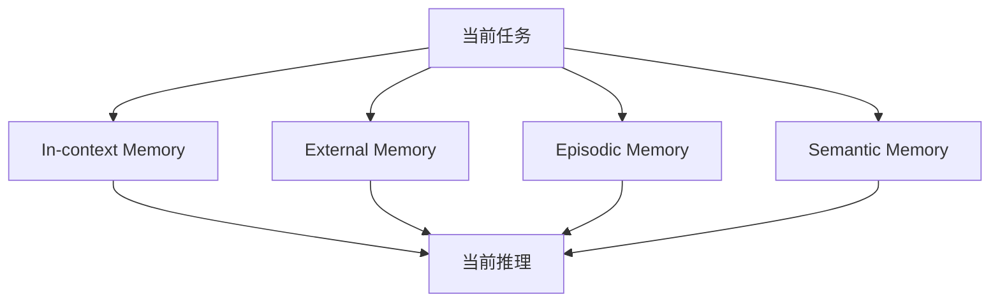
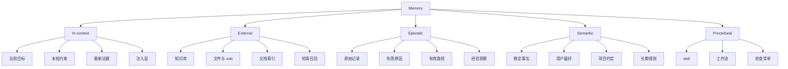
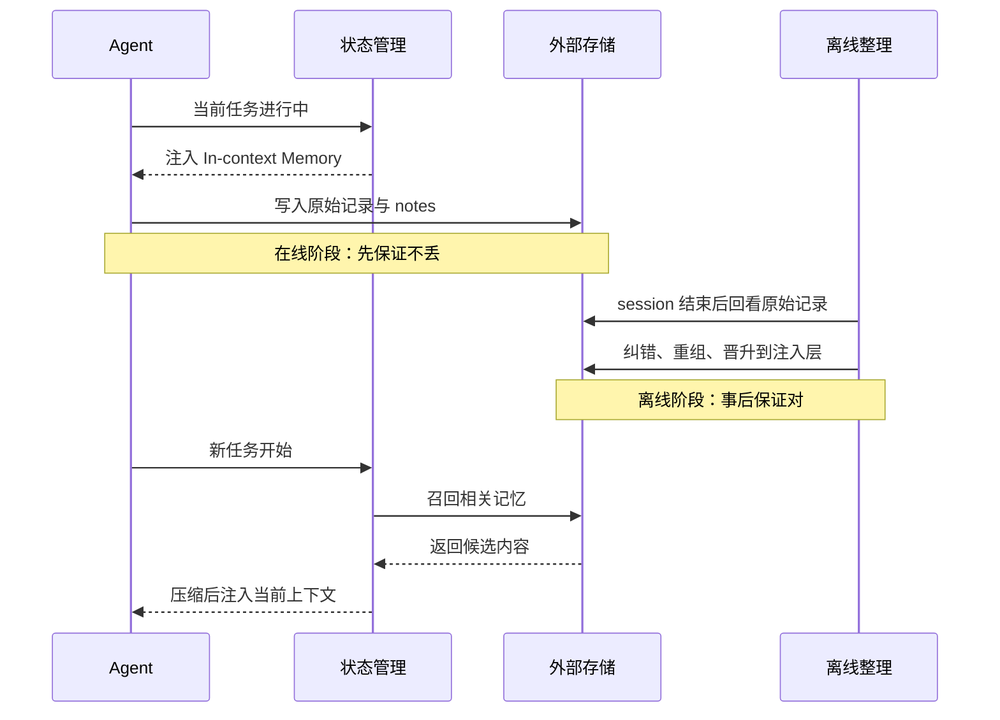

<KnowledgeMap current-module="memory" current-article="Memory 的四种形态" />

# Agent 为什么会失忆：Memory 的四种形态

<ArticleHeader
  module="Memory 体系"
  :tags="['原理']"
  reading-time="20 分钟"
  prerequisite="理解上下文窗口"
  summary="Agent 的记忆不是一块统一的大缓存，而是不同层次的系统设计：工作记忆管当前、外部记忆管可召回信息、情节记忆管经验过程、语义记忆管稳定知识。四种形态之外，还需要区分记忆所处的位置、承担的功能，以及它在系统里被加工到了哪一步。"
/>

## 四种记忆形态

- In-context Memory：直接放在窗口里的信息
- External Memory：存在模型外部、按需召回的信息
- Episodic Memory：关于做过什么、结果如何的过程记录
- Semantic Memory：相对稳定的事实与规则沉淀

这四种记忆不是学术分类游戏，而是 Agent 架构里非常实用的职责划分。

一旦不区分它们，就容易把所有信息都丢进一个大池子里，最后得到一个“什么都记了，但什么都记不好”的系统。

需要先说明一点：这四类并不在同一个维度上。In-context 与 External 回答的是“信息放在哪里”，Episodic 与 Semantic 回答的是“信息是什么性质”。后文会专门有一节把两个维度拆开，这也是“同一份文档可以同时是两种形态”这类混淆的来源。

## 先看一张总图



这张图的重点不是“有四个框”，而是说明：

`Agent 的记忆不是一个地方，而是多层来源共同影响当前推理。`

## 为什么 Agent 会失忆

因为模型本身天然是无状态的。

每次调用开始时，它能看到什么，取决于这次给了它什么。

如果没有额外的记忆设计，它并不会天然记住：

- 上一轮做过什么
- 哪一步已经失败过
- 用户的长期偏好
- 哪些事实是稳定成立的

也就是说，模型并不是“记性不好”，而是它本来就没有默认的长期记忆机制。  
所谓 Memory，本质上是宿主系统为了让它在多轮、多任务和跨会话里保持连续性，而补上的一套外部结构。

2025 年底的综述 [Memory in the Age of AI Agents](https://arxiv.org/abs/2512.13564) 把这件事表述为：Agent 记忆是一个持续、会自我演化的系统，用来在长时间跨度里维持一致性与适应性，这与单次推理里对上下文的临时管理（context engineering）、对静态知识的检索（RAG）是三件相关但不同的事。

## In-context Memory：最快，但最贵

这类记忆直接放在当前上下文里。

它的优点是：

- 零额外检索成本
- 与当前任务强绑定
- 最容易立即影响推理

它的缺点也很明显：

- 占用窗口
- 成本高
- 难以跨会话持久化

所以它更像“工作记忆”，适合放当前阶段最关键的少量信息。

典型内容包括：

- 当前任务目标
- 本轮必须遵守的约束
- 刚刚得到的关键工具结果
- 当前阶段的待办状态

这类信息的特点是：对下一轮推理立刻有用，但未必值得长期保存。

有一类内容需要单独留意：**每次 session 开头自动注入的那一部分**。它跨 session 存在，却又占用每一次的窗口，因此成本最高，必须精简。Claude Code 的 auto memory 只会加载 `MEMORY.md` 的前 200 行或 25 KB，让它充当索引，细节留在文件里按需读取，原因就在这里。

## External Memory：能存下来，但不代表能找回来

很多系统把 External Memory 简化成“接个向量库”。

这当然是其中一种形式，但核心问题从来不只是存，而是：

- 存什么
- 怎么切分
- 什么时候写入
- 如何召回
- 如何让结果重新进入上下文

所以 External Memory 真正解决的是“能否把窗口外信息带回来”，而不是简单的“有没有数据库”。

这里最容易被低估的一点是：

`存储能力 != 召回能力`

可以把几百万条信息都存下来，但如果：

- 切分不合理
- 元数据缺失
- 查询改写很差
- 召回后排序混乱

那么系统仍然会表现得像“记不住”。

External Memory 的载体也不止向量库。近期的常见做法包括：

- 向量库：按语义相似度召回
- 图存储：按实体与关系推理
- 文件系统：把记忆写成 Markdown 文件，由模型自己用搜索与读取工具查找，人也可以直接阅读和编辑

具体怎么选，见《向量库与图存储的选型对比》。

## Episodic Memory：记录做过什么

这类记忆更像经验日志。

它关心的不是稳定知识，而是过程本身：

- 在什么任务里
- 做了哪些动作
- 遇到了什么问题
- 最后结果如何

对于 Coding Agent 或自动化系统来说，这类记忆很重要，因为它能帮助系统避免重复试错。

例如在代码场景里，一条高价值的 episodic 记忆可能是：

- “昨天修改部署配置失败，原因是漏掉了基础路径”
- “这个项目里已经验证过 `npm run build` 是最终检查手段”

它们不是一般知识，而是来自系统真实经历的经验。

Episodic 内部还可以再分两层：

- **原始记录（transcripts）**：完整、按时间追加的事件日志，不加工，也不应被改写。它是事后校验的依据。
- **提炼后的观察（notes）**：Agent 在过程中挑出来写下的“值得记住的事”，会出错，也会过时。

这两层的区别在后文“记忆的加工层级”里会反复用到。

## Semantic Memory：沉淀稳定知识

这类记忆更接近规则、事实和长期知识。

例如：

- 项目约定
- 稳定的领域事实
- 用户长期偏好
- 被反复验证过的经验总结

和 Episodic Memory 相比，Semantic Memory 更强调“抽象后的结论”，而不是某一次具体过程。

这也是为什么很多系统最终会把一部分 episodic 记忆“蒸馏”成 semantic 记忆。  
例如：

- 一次次任务里都发现用户偏好中文回复
- 多次构建后确认项目部署基础路径固定
- 多轮协作后确认 README 需要在任务完成后同步更新

这些都更适合作为长期稳定规则，而不是只留在某次会话记录里。

## 补充：Procedural Memory，记录“怎么做”

认知架构方面的文献（例如 CoALA）在工作记忆、情节记忆、语义记忆之外，还会单独列出**程序性记忆（procedural memory）**。它记录的不是“发生过什么”或“什么是真的”，而是“某类事情应该怎么做”。

在 Agent 系统里，它的主要载体是：

- skill：一组可复用的做法，按需加载
- 工作流与检查清单：固定的操作顺序
- 提示词与工具使用约定

以前面的部署场景为例，三类记忆可以对应成这样：

| 类型 | 内容 |
| --- | --- |
| Episodic | “上周部署失败，原因是 `base` 配置遗漏” |
| Semantic | “本站线上部署必须带 `/ai-guide/` 基础路径” |
| Procedural | “发布前先执行 `npm run build`，再检查构建产物中的链接是否带基础路径” |

综述把这类内容归为 experiential（经验性）记忆的一部分，与案例、策略并列。本站的《自进化 Skills》一章讨论的，正是程序性记忆如何从经验中被提炼、验证和更新。

## 一张脑图：记忆分别在管什么



## 一个简单的结构示例

```python
memory = {
    "in_context": ["当前任务目标", "本轮必须遵守的约束"],
    "external": ["知识库文档", "历史会话摘要"],
    "episodic": [
        {
            "content": "昨天修改配置失败，因为环境变量缺失",
            "source": "session_0412",   # 指向原始记录，方便事后校验
        }
    ],
    "semantic": [
        {
            "content": "当前项目默认使用 Python 3.11",
            "verified": True,
            "source_episodes": ["ep_1023", "ep_1045"],
        }
    ],
    "procedural": ["发布前先执行构建，并检查产物中的链接"],
}

print(memory)
```

这段代码当然不能直接代表真实系统，但它已经揭示了两个关键点：

- 不同类型的信息，天然就应该放在不同层次的记忆结构里。
- 越靠近“稳定知识”的记忆，越需要带上来源与验证状态，否则出错之后无从追溯。

## 四种记忆最容易混淆在哪里

### Episodic 和 Semantic 很像，区别到底是什么

这是最容易混淆的一组。

- `Episodic` 更像一次经历
- `Semantic` 更像从多次经历中提炼出来的结论

举个例子：

- Episodic: “上周修复部署问题时，发现是 `base` 配置不对”
- Semantic: “这个项目线上部署必须带 `/ai-guide/` 基础路径”

前者是一次事件，后者是稳定知识。

### In-context 和 External 也容易混

- `In-context` 是已经放到当前窗口里的内容
- `External` 是还在窗口外，需要被召回的内容

所以“同一份文档”有可能同时以两种形态存在：

- 平时存在外部知识库里，是 External
- 被检索后放进当前轮 prompt 里，就变成了 In-context

### Semantic 和 Procedural 的边界

- `Semantic`：什么是真的（“部署必须带 `/ai-guide/` 基础路径”）
- `Procedural`：怎么去做（“发布前先构建，再检查链接”）

二者经常成对出现，一条规则往往同时对应一个检查动作。区分的好处是存放和更新的方式不同：事实需要核对是否过期，做法需要验证是否仍然有效。

## 四种形态不在同一个维度上

前面提到，In-context / External 是“位置”，Episodic / Semantic / Procedural 是“功能”。把两个维度画成一张表，会更清楚：

| | 在窗口内（in-context） | 在窗口外（external） |
| --- | --- | --- |
| 工作记忆 | 当前目标、约束、阶段状态 | （不适用） |
| Episodic（经历） | 本轮刚发生的事件 | 历史任务日志、transcripts |
| Semantic（知识） | 被注入的规则与偏好 | 知识库、wiki、长期 notes |
| Procedural（做法） | 已加载的 skill | skill 库、工作流 |

这张表解释了几个常见现象：

- 同一条 semantic 知识，平时在窗口外，被召回后进入窗口内，类型没变，位置变了。
- “记忆管理”的相当一部分工作，其实是在决定**哪些内容在窗口内、哪些在窗口外**，也就是位置的迁移，而不是类型的转换。
- 评估记忆系统时，也要分开问：存对了吗（功能），找回来了吗（位置迁移）。

综述采用了另一套三维度：Forms（token 级、参数级、潜在表示，回答“记忆用什么承载”）、Functions（事实性、经验性、工作记忆，回答“记忆为什么存在”）、Dynamics（形成、演化、检索，回答“记忆如何随时间变化”）。本文的“位置与功能”大致对应其中的 Forms 与 Functions，而 Dynamics 对应下一节的内容。

## 记忆的加工层级

除了“是什么”和“在哪里”，还有第三个问题：**这条记忆在系统里被加工到了哪一步**。Anthropic 在 2026 年 11 月的文章 [The components of agent memory](https://www.anthropic.com/research/components-of-agent-memory) 里给出了一个四层划分：

| 层级 | 内容 | 谁写入 |
| --- | --- | --- |
| Transcripts | 完整、可搜索的事件日志 | 系统自动记录 |
| Memory notes | Agent 写下的显著观察 | 在线，session 内 |
| Memory representations | 整理后的结构，如带链接的 wiki | 离线整理 |
| Injected context | 每次 session 开头预加载的内容 | 离线晋升，保持精简 |


这个层级与前面的四种形态是正交的。一条经验可能先是 transcript 里的一段对话（Episodic，External），后来被写成一条 note，再被整合进 wiki 的某一页（Semantic，External），最后凝缩成注入层里的一行（Semantic，In-context）。

层级之间的搬运由两类动作完成：

- **在线写入**：Agent 在 session 内判断什么值得记，写成 notes。
- **离线整理**：在 session 之间回看原始记录，纠错、重组、晋升。这一过程被称为 dreaming，是《在线记录与离线整理》一篇的主题。

这个划分的价值在于，它说明了记忆系统为什么需要“两个时间尺度”：写入发生在不知道后续会怎样的时刻，整理可以发生在已经知道的时刻。

## 为什么这几类必须分开看

因为它们服务的问题不同：

- `In-context`：解决当前任务正在想什么
- `External`：解决窗口外能否召回相关内容
- `Episodic`：解决系统是否能从经历中学习
- `Semantic`：解决稳定知识如何沉淀和复用
- `Procedural`：解决做事的方法如何复用和改进

一旦把这些职责混在一起，系统通常会出现两类问题：

- 该短期保留的信息被长期堆积
- 该长期沉淀的知识却没有被结构化保存

## 一个更接近真实系统的写入与召回流程



这个流程里，真正关键的是中间那层状态管理与召回策略，以及在线与离线两个阶段的分工，而不是“有没有存储系统”。

## 写入时的一个判断：什么值得存

四种形态确定了“可以存什么”，但“此刻要不要存”是另一个问题。Anthropic 在 *Pokémon Red* 上的一组对照说明了这一点：Claude Sonnet 3.7 在约 10,000 步时写了 413 个 memory 文件，拿到 1 枚徽章；Claude Fable 5 只写了 9 个文件加一个 `global.md`，拿到 4 枚徽章。

差异来自一个简单的原则，可以称为**可再得性原则**：屏幕上每回合都能读到的信息（金钱、坐标）不值得存，只存环境不会重新给出的东西，也就是策略、计划和验证过的规则。

这个原则与前面的分类可以直接结合：

- 工具能重新返回的结果，不写入 Episodic。
- 配置文件里能直接读到的事实，不写入 Semantic。
- 写入的条目应当带上依据，便于事后校验。

具体的触发时机与遗忘机制，见下一篇《记忆的写入时机与遗忘策略》。

## 工程上的真实挑战

真正困难的地方并不是“理解几种名称”，而是做决策：

- 什么内容该写进哪一类记忆
- 什么时机触发写入
- 什么时机触发召回
- 怎样控制噪声和过期信息
- 写入之后，如何发现并纠正错误

这也是为什么 Memory 设计本质上是系统架构问题，而不是简单的“加个检索功能”。

LangChain 在长期记忆相关资料里也强调，设计 memory 之前最好先问三件事：系统要学什么、哪些知识应该长期保留、什么条件下应该触发召回。这和这里的分类思路是高度一致的。[LangMem SDK for agent long-term memory](https://blog.langchain.com/langmem-sdk-launch/)

## 一些很实用的设计判断

### 什么适合写成 Episodic

- 一次任务里的关键尝试
- 明显失败或成功的路径
- 对后续类似任务有借鉴价值的过程

### 什么适合写成 Semantic

- 稳定成立的项目规则
- 用户长期偏好
- 被多次验证的领域事实

### 什么适合写成 Procedural

- 多次重复、步骤相对固定的操作
- 已被验证有效的检查清单
- 需要在不同任务里复用的做法

### 什么不该轻易写入长期记忆

- 一次性噪声
- 未验证的猜测
- 很快会过期的临时状态
- 环境随时可以重新给出的信息
- 与后续任务几乎无关的细节

如果长期记忆里噪声过多，系统并不会变聪明，只会更容易被旧信息带偏。

## 本节总结

- Memory 的几种形态不是概念游戏，而是对不同信息职责的工程划分
- In-context 管当前，External 管窗口外召回，Episodic 管经历，Semantic 管稳定知识，Procedural 管做事的方法
- 这些形态分属“位置”和“功能”两个维度，位置之间的迁移是记忆管理的主要工作之一
- 记忆在系统里还有“加工层级”：transcripts、notes、representations、注入层，层级之间由在线写入和离线整理搬运
- 同一个信息会随着阶段变化在不同形态与层级之间流动
- 真正困难的不是“存下来”，而是决定写什么、怎么召回、何时清理，以及写错之后怎么发现

## 和后续模块的关系

这一篇解决的是“记忆应该怎样分类”。

接下来《记忆的写入时机与遗忘策略》会回答另一个更具体的问题：什么时候该写入、什么时候该遗忘，以及新旧信息冲突时怎么处理。之后的 `RAG` 会继续回答：当信息放在窗口外之后，如何在需要时把它准确召回。

## 下一步建议

继续阅读 [记忆的写入时机与遗忘策略](./write-timing-and-forgetting-policy)。

如果想先了解记忆如何在写入之后被校验与整理，可以直接阅读 [在线记录与离线整理：dreaming](./dreaming-offline-consolidation)。

<div class="key-insight">
  <div class="key-insight-label">核心洞察</div>
  <p class="key-insight-text">
    Agent 的记忆设计不是存更多信息，而是把不同类型的信息放进不同层次的记忆系统，再在恰当的时候调回来；并且要承认，写入时的判断会出错，所以需要事后校验的机会。
  </p>
</div>