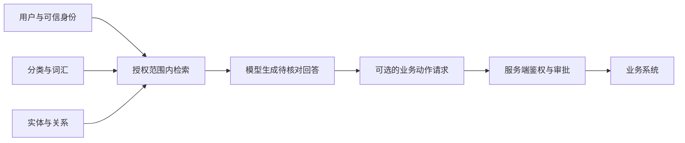

<KnowledgeMap current-module="ontology" current-article="Ontology vs Taxonomy vs Knowledge Graph vs RAG：四条边界怎么画" />

# Ontology、Taxonomy、Knowledge Graph 与 RAG：如何区分和组合

<ArticleHeader module="本体论与知识表示" :tags="['进阶', '建模']" reading-time="12 分钟" prerequisite="了解知识检索与 Agent 工具调用" summary="从退款规则案例出发，分清分类体系、概念约束、知识图谱与检索增强生成；再把授权和审批放到真正执行它们的服务端。" />

用户询问“这笔订单能否退款？”系统可能需要找到相关规则、确定订单和规则的关系、生成解释，最后由有权的人或服务执行退款。一个技术名词无法自动完成所有步骤：**分类、概念定义、事实关系、检索生成和业务授权是不同的问题**。

<span id="四条能力-四层问题"></span>

## 四种概念，关注点可以重叠

| 概念 | 主要关注点 | 退款案例中的例子 | 不应自动假设 |
| --- | --- | --- | --- |
| Taxonomy，分类体系 | 用类别、层级和受控词汇组织内容 | “售后 → 退款规则” | 分类标签本身已经决定谁能退款 |
| Ontology，本体 | 定义领域中的概念、关系及其语义和约束 | `订单`、`退款规则`、`适用`的定义 | 一份本体文件天然执行权限、审批或资金操作 |
| Knowledge Graph，知识图谱 | 用实体与关系组织可查询的知识 | “规则 R1 适用于订单类型 A” | 图中的每条关系都真实、最新或经过审批 |
| RAG，检索增强生成 | 先检索外部信息，再让生成模型利用检索结果 | 检索 R1 的原文，让模型解释 | 一定使用向量库，或检索到就意味着答案正确 |

这不是四个互斥的数据库产品，也不是必须依次采购的四层。本体可以为知识图谱提供语义；图谱可以参与检索；检索可以采用关键词、向量、图查询或组合方式。一个简单应用也可能只需要分类、全文搜索和服务端规则，不必一开始引入全部组件。

<span id="_1-taxonomy-只管-属于哪里-不管-是谁与谁之间是什么关系"></span>
<span id="它擅长"></span>
<span id="它不擅长"></span>

## 1. Taxonomy：先把东西组织起来

分类体系帮助人们用一致的类别查找、浏览和过滤。例如把规则分为“退款”“换货”和“配送”，再把“退款”细分为“未发货退款”和“已发货退款”。分类标签可以是内容的一部分，也可以用于缩小搜索范围。

分类体系并不总是只有一棵简单的树。[W3C 的 SKOS 指南](https://www.w3.org/TR/skos-primer/)描述了较宽泛、较狭窄和关联等概念关系。无论采用哪种结构，都需要有人维护类别的定义和版本；“标记为退款规则”本身不等于该规则适用于当前订单。

<span id="_4-ontology-可执行本体-把-世界怎么运行-写进运行时"></span>

## 2. Ontology：明确词语与关系的含义

当不同团队都说“有效订单”却指代不同状态，系统即使检索很快，也可能把不相干的数据连在一起。本体可以明确：有哪些类、哪些关系、它们的含义与某些可形式化的约束。具体表达能力取决于所用语言和系统；[W3C 的 OWL 2 Primer](https://www.w3.org/TR/owl-primer/)介绍了类、属性与公理等基本元素。

例如，“退款规则适用于订单类型”定义了一个关系的**语义**；“只有授权审核人可批准具体退款”则是业务控制，需要由身份、权限和执行服务落实。某些产品会把对象模型、动作、权限和工作流组织在同一个平台里，但不能由此推断一般的本体语言或本体文件会自动完成这些控制。

形式化约束、推理与数据库校验也不是同一件事：例如某条知识缺失，在不同语义和系统中不一定等价于“确定为假”。在业务写入口仍应明确校验条件、失败行为和测试。

<span id="_2-knowledge-graph-只管连接-不管-这条边怎么进来的"></span>
<span id="它擅长-1"></span>
<span id="它不擅长-1"></span>

## 3. Knowledge Graph：记录和查询实体关系

知识图谱可以记录“规则 R1 适用于订单类型 A”“订单 O1 属于类型 A”。它可以采用 RDF 三元组、属性图或其他实现，**不等同于某一种图数据库**。关系与节点也可以连接来源、时间和版本；是否保存以及如何验证这些信息，取决于数据管道与治理设计。

例如，用图查询可以找到适用于某类订单的规则候选；但如果 R1 已经过期，或者用户无权读取它，图中存在一条边仍不足以授权系统执行退款。应在写入、更新和读取时明确来源、有效期与访问控制，而不是期待图结构替代这些机制。

<span id="_3-rag-向量库-只管-可能相关的文本片段-不管-事实是否成立"></span>
<span id="它擅长-2"></span>
<span id="它不擅长-2"></span>

## 4. RAG：检索和生成组成一条链

RAG 的核心是让生成过程使用检索到的外部信息。原始 [RAG 论文](https://arxiv.org/abs/2005.11401)使用了稠密向量检索；这不意味着所有后续 RAG 实现都必须只用向量。实践中可以结合关键词、语义检索与其他数据源；[OpenAI 的检索文档](https://developers.openai.com/api/docs/guides/retrieval)提供了语义匹配与关键词匹配的混合示例。

一次可解释的知识问答至少要区分：用户是否有权访问资料、检索结果是否相关且有效、回答是否得到引用支持。检索命中只回答“找到了候选材料”，不能单独证明规则适用、答案正确或用户有权触发动作。检索、引用核验与授权可以分别失败，也需要分别评估。

## 5. 动手：同一个问题经过哪些判断

以下纯 Python 示例用虚构数据展示**分类、关系、关键词候选和服务端门禁**的位置；它不调用模型，也不是一个完整的 RAG 系统。保存为 `layers.py` 后运行 `python3 layers.py`：

```python
# 虚构数据：标签、关系和原文分别回答不同问题。
categories = {"R1": "退款"}
relations = [("R1", "适用订单类型", "A")]
documents = {"R1": "A 类订单退款需审核。"}

# 一个极简关键词检索；不是向量检索，也不做语义理解。
candidates = [doc_id for doc_id, text in documents.items() if "退款" in text]
applicable = [doc_id for doc_id, relation, target in relations
              if doc_id in candidates and relation == "适用订单类型" and target == "A"]
print("分类:", categories["R1"])
print("候选规则:", applicable)

# 这是服务端业务规则的演示，不是本体或模型自动执行的权限控制。
def may_refund(role, approved):
    return role == "reviewer" and approved is True

print("普通客服能执行退款:", may_refund("support", False))
assert applicable == ["R1"]
assert not may_refund("support", False)
```

预期输出包括“分类: 退款”“候选规则: ['R1']”以及 `False`。`may_refund` 中的角色和批准值只是调用者传入的教学数据；真实服务必须从可信身份和持久化审批记录获取它们，还要检查订单、租户、金额、审批版本和有效期。该例也没有检测规则过期或验证用户是否有权读取资料。

<span id="_5-推荐的组合方式"></span>

## 6. 组合时先画清边界



图中箭头是一个**示意流程**，不是所有应用的唯一架构。业务对象和关系的语义可以由本体或其他模式定义；数据来源、版本、授权和审批由具体组件共同维护。对写操作，模型只能提出请求，执行端必须独立确认身份、目标、参数和授权。

要验证这条边界，可运行本站[企业知识助手本地实验](../agent/cases/enterprise-agent-local-lab)：它演示同租户查询、文档版本、人工审批和模拟工单，但仍不具备生产级身份认证、完整检索或真实外部系统。

<span id="本节总结"></span>
<span id="下一步"></span>

## 练习与延伸阅读

1. 为你的场景列出三个类别、两个实体类型和一种关系；分别说明它们在哪里维护。
2. 设计一道“召回了过期规则”的测试，写出检索结果、模型回答和执行端各自应如何处理。
3. 决定一项敏感操作由哪个可信服务检查权限；不要把批准状态作为模型可自行填写的参数。

- [W3C：SKOS Primer](https://www.w3.org/TR/skos-primer/) 与 [OWL 2 Primer](https://www.w3.org/TR/owl-primer/)：查看知识组织和本体语言的概念与边界。
- [Lewis 等：Retrieval-Augmented Generation](https://arxiv.org/abs/2005.11401)：了解原始 RAG 模型的检索与生成设计。
- 站内继续阅读 [Foundry 语义与动作](./foundry-object-link-action-function)、[Cruxible 历史版本建模](./cruxible-yaml-ontology)和 [多方关系与超图](./hypergraph-enterprise-multi-agent)。

资料核验日期：2026-11-27。
